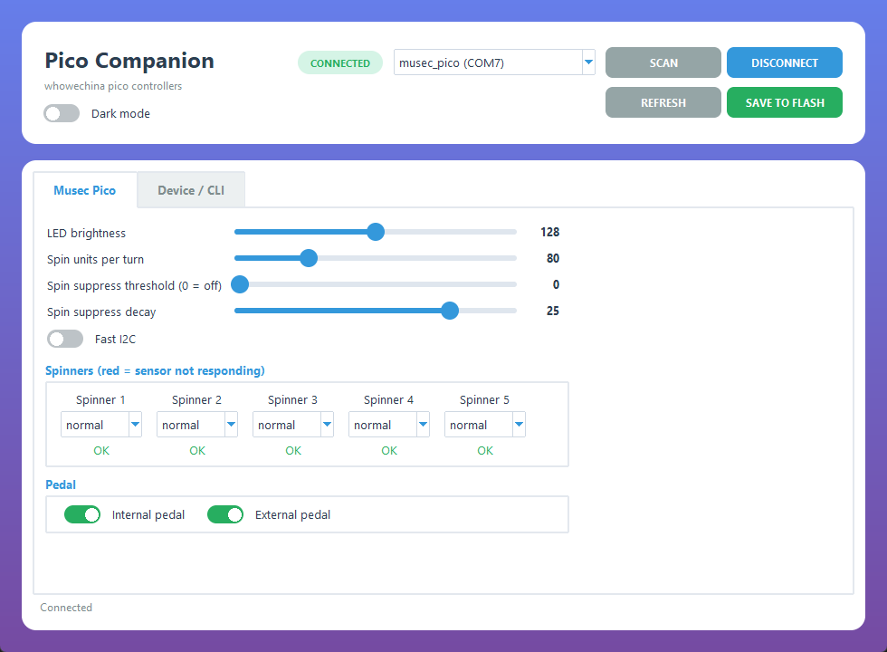
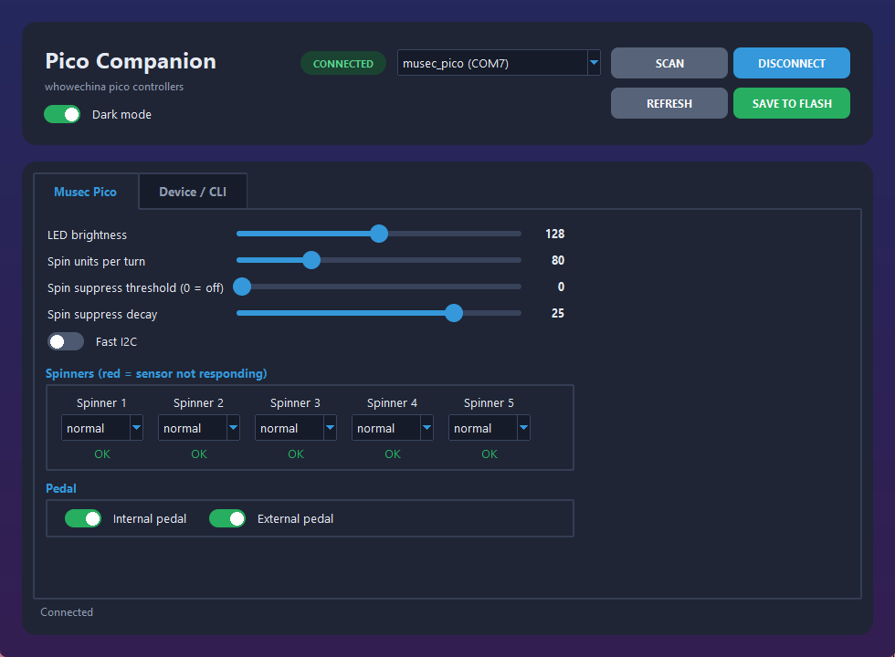

#  pico-companion

A small desktop companion app for [whowechina](https://github.com/whowechina)'s "pico" arcade-style controllers.
Change a controller's saved settings from your PC instead of using the buttons on the device.

It talks to the controller's built-in command-line interface over its USB serial port (the same thing the
projects' web configurators and `?` / `display` / `save` commands use), so no drivers and no extra installs are needed.
Windows only, no Python required when you use the release `.exe`.

<p align="center">
  
  
</p>
<p align="center"><i>Light and dark mode, remembered between starts.</i></p>

## Supported devices

The app identifies each controller by the prompt its CLI prints (for example `musec_pico>`) and builds the screen
from what the device itself reports, so older firmware simply shows fewer options.

| Device | Status |
|---|---|
| IIDX Pico (`iidx_pico`) | Tested on hardware. Full settings need the small firmware patch in [`firmware/`](firmware/); on stock firmware you get the Hall-key trigger distances, calibration, save, and the console. |
| Musec Pico (`musec_pico`) | Tested on hardware (stock firmware, older and newer builds). |
| AIC Pico / AIC Touch (`aic_pico`) | Tested on hardware (two units, older and newer firmware). |
| popn, dance, rock, nos, bishi, voltex, arcade, chord, groove, ju, geki, chu, mai, diva, densha | **Written from the projects' firmware source and not tested on real devices.** Screens are marked as such in the app. Please open an issue if one looks wrong. |
| any other `*_pico` | Generic screen: LED brightness (if reported) and a console. |

## Download and use

1. Download `PicoCompanion.exe` from the [latest release](../../releases/latest) and run it.
2. Plug in your controller. It is detected automatically and the app rescans when you plug or unplug something.
3. Change settings. Changes apply immediately and the device writes them to flash after a few seconds
   (or press **Save to flash**).

## Updating firmware

Drop a `.uf2` firmware file anywhere in the window (or use **Browse...** on the **Firmware** tab). The app:

1. checks that it is a valid UF2 for an RP2040/RP2350 and that it is for the connected controller (it warns if the
   firmware looks like it belongs to a different one),
2. asks you to confirm and saves your current settings as a text file in a `PicoCompanion\Backups` folder (under Documents, or under `%APPDATA%` if
   there is no Documents folder; the Firmware tab has an **Open backups folder** button),
3. reboots the controller into update mode, copies the file to the `RPI-RP2` drive, and waits for the restart,
4. reconnects and shows the new build date.

It also works if the controller is already in update mode (BOOTSEL). Some firmware versions reset the settings to
defaults, which is what the backup is for. Do not unplug the controller while it runs.

### Check for newer firmware

**Check for updates** (Firmware tab) looks in the controller's original project repository
(`github.com/whowechina/<project>`) for its published `.uf2`, downloads it and compares the build time inside it with
the one your controller reports. If it is newer you see the date and the author's latest commit message, and
**Update now** sends it through the same checks, backup and confirmation as above. Nothing is written without your
confirmation.

- It needs internet access. Most checks download the file straight from the repository and use no GitHub API request
  at all; the few that do (an unusual file name, or fetching the author's commit message when something newer exists)
  fall under GitHub's limit of 60 anonymous API requests an hour per network.
- Projects that publish no ready-made firmware (currently `arcade_pico` and `densha_pico`) are reported as such.
- A controller running a newer or custom build than the published one (for example the patched IIDX firmware) is
  reported as "nothing newer". For IIDX the app also warns that the published firmware lacks the configuration
  commands this app uses, and that newer IIDX firmware may need a Pico W.

Notes:
- Only one program can use a serial port at a time. Close the web configurator or any serial terminal that is connected
  to the same controller.
- **Firmware update mode** and **Factory reset** (Device / CLI tab) always ask for confirmation.
- Windows SmartScreen may warn about an unsigned app the first time you run the exe.

## Run from source

Python 3.12+ on Windows, standard library only:

```powershell
python pico_companion.py
```

## Build the exe

```powershell
pip install pyinstaller
./build.ps1
```

The result is `dist/PicoCompanion.exe`. The icon is `assets/icon.ico`, drawn by `python tools/make_icon.py` (no
extra packages needed).

## Files

| File | Purpose |
|---|---|
| `pico_companion.py` | The app (window, device scan, per-device screens for IIDX, Musec, AIC) |
| `profiles.py` | Table-driven settings for the other devices, written from their firmware |
| `serial_link.py` | Serial connection to the controller's CLI (Win32 COM port, no pyserial) |
| `iidx_screens.py` | IIDX Pico screens and the Hall-key screen shared by Hall-effect controllers |
| `firmware_update.py` | UF2 validation, update-drive detection, the flash sequence and settings backups |
| `firmware_check.py` | Finds the published firmware in the original project repository and compares versions |
| `firmware_ui.py`, `filedrop.py` | The Firmware tab and the drag-and-drop hook (Windows API through ctypes) |
| `theme.py`, `shapes.py` | Look and feel (light/dark, anti-aliased rounded shapes without Pillow) |
| `tests/test_profiles.py` | Runs every profile against sample `display` output |
| `tests/test_firmware_update.py` | Tests UF2 checks and the flash sequence with a simulated update drive |
| `tests/test_firmware_check.py` | Tests the update check with fake GitHub answers (no network) |
| `firmware/` | Patch that adds configuration commands to the IIDX Pico firmware |

## License

The app in this repository is released under the [MIT License](LICENSE).

`firmware/commands_cfg.patch` modifies whowechina's IIDX Pico firmware, which is GPL-3.0, so that patch is under the
[GPL-3.0](firmware/LICENSE) (see [`firmware/README.md`](firmware/README.md)). Third-party components of the release
exe are listed in [`THIRD_PARTY_NOTICES.md`](THIRD_PARTY_NOTICES.md).

This is an unofficial community tool, not affiliated with or endorsed by whowechina. The upstream hardware and
documentation are CC BY-NC; please respect their terms and support the original author.
